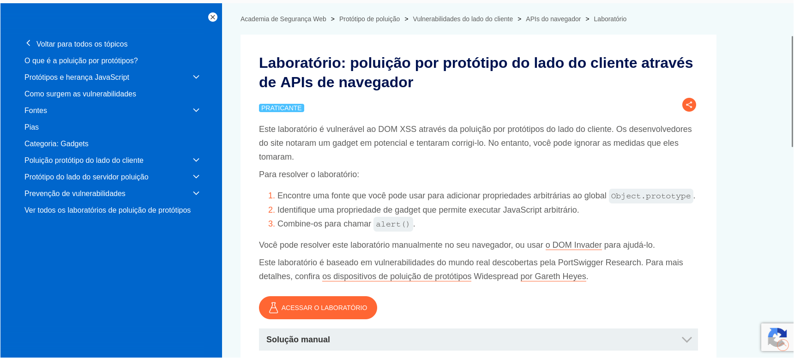
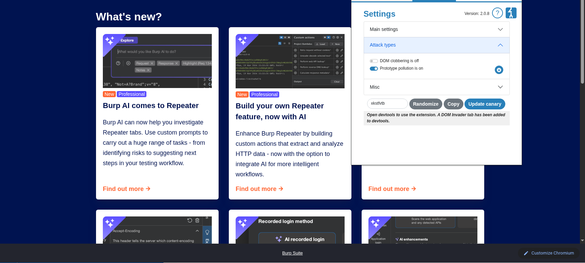
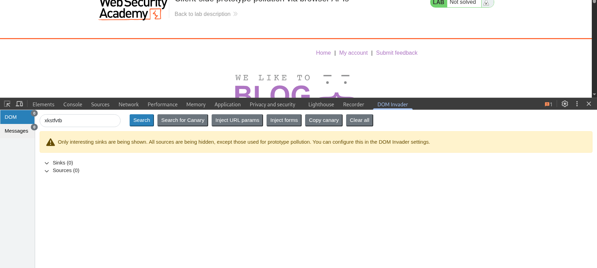
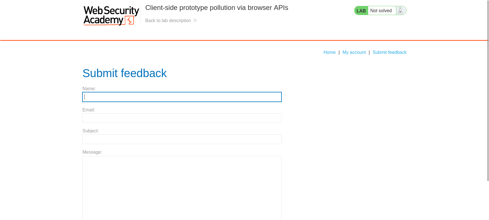
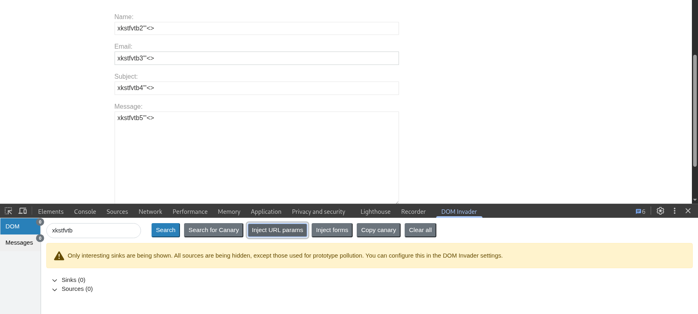
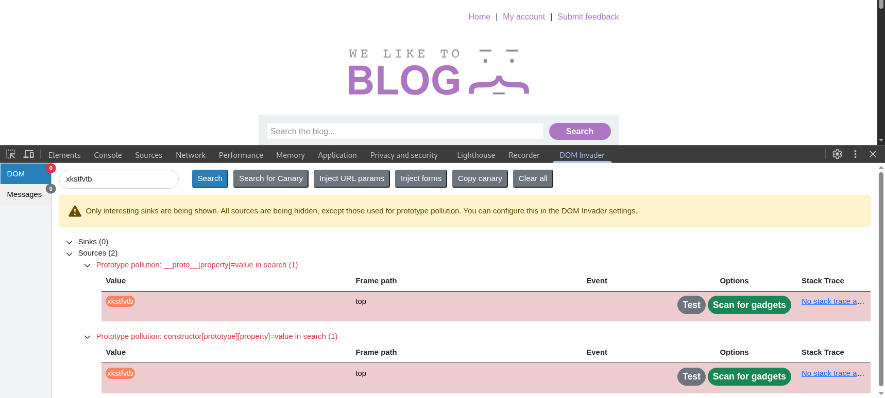
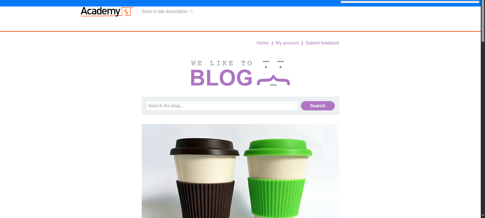
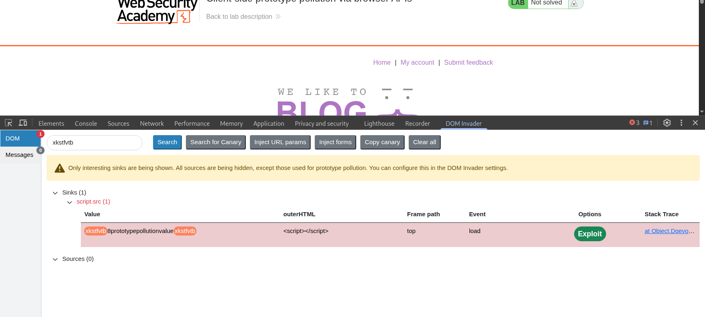
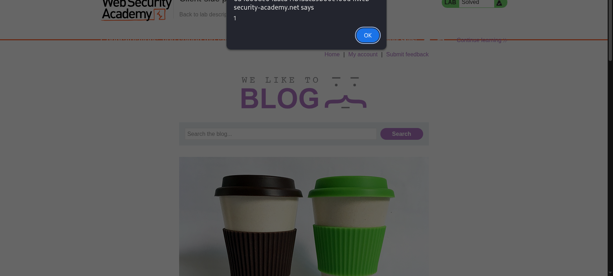
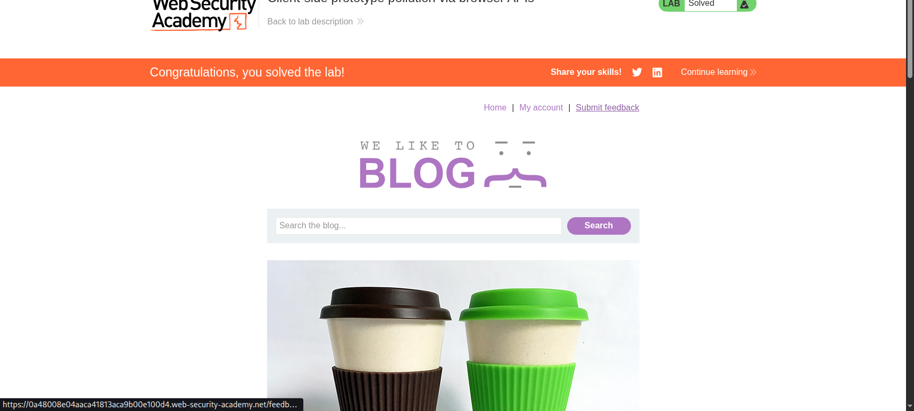

# LAB-Portswigger-Client-side-prototype-pollution-via-browser-APIs-write-up

Client-side prototype pollution via browser APIs

> Write-up do lab da **PortSwigger Web Security Academy** sobre poluição de protótipo do lado do cliente (client-side prototype pollution) explorada através de APIs do navegador, usando a extensão **DOM Invader** do Burp Suite.

## Resumo

| Item | Detalhe |
|---|---|
| **Plataforma** | PortSwigger Web Security Academy |
| **Lab** | [Client-side prototype pollution via browser APIs](https://portswigger.net/web-security/prototype-pollution/client-side/browser-apis/lab-prototype-pollution-client-side-prototype-pollution-via-browser-apis) |
| **Dificuldade** | Practitioner |
| **Categoria** | Client-side Prototype Pollution → DOM XSS |
| **Classificação** | CWE-1321 (Improperly Controlled Modification of Object Prototype Attributes) · OWASP Top 10 2021: A03 (Injection) |
| **Ferramentas** | Burp Suite (navegador embutido) + extensão **DOM Invader** |
| **Credenciais do lab** | Não é necessário login |

---

## Contexto e objetivo

A aplicação é vulnerável a **DOM XSS através de poluição de protótipo no lado do cliente**. Segundo a própria descrição do lab, os desenvolvedores perceberam que havia um "gadget" (um ponto de código perigoso, capaz de executar JavaScript arbitrário) em potencial e tentaram corrigi-lo. Porém, a medida tomada pode ser contornada.



**Objetivo**, segundo o próprio lab:

1. Encontrar uma **fonte** (source) que permita adicionar propriedades arbitrárias ao `Object.prototype` global.
2. Identificar uma propriedade de **gadget** que permita executar JavaScript arbitrário.
3. Combinar as duas coisas para disparar um `alert()`.

---

## Sobre o material de leitura e por que ele "não aparece" diretamente neste write-up

O trecho de leitura usado como base teórica (*Bypassing flawed key sanitization*) descreve um erro comum: a aplicação tenta remover a string `__proto__` das chaves recebidas, mas faz isso **sem repetir o processo recursivamente**. Assim, um payload "aninhado" como:

```
vulnerable-website.com/?__pro__proto__to__.gadget=payload
```

ao passar por uma sanitização que remove `__proto__` **uma única vez**, vira:

```
vulnerable-website.com/?__proto__.gadget=payload
```

ou seja, a própria remoção malfeita "reconstrói" a string perigosa.

Resolvi este lab usando a configuração de **DOM Invader** no navegador embutido do Burp Suite, em vez de montar esse payload aninhado manualmente. Por isso, o fluxo abaixo não mostra, passo a passo, o encadeamento `__pro__proto__to__`, pois essa mesma lógica é **automatizada pelo DOM Invader**.

### Como a configuração do DOM Invader faz o que a seção de resolução descreve

O DOM Invader, quando o modo **Prototype pollution** está ativado, intercepta e testa automaticamente os pontos de entrada da página (parâmetros de URL, campos de formulário, hash, etc.) injetando um valor "canário" (um identificador único, no meu caso `xkstfvtb`) em diferentes formatos de chave conhecidos por causar poluição de protótipo, entre eles:

- `__proto__[prop]=valor`
- `constructor[prototype][prop]=valor`
- variações obfuscadas/aninhadas, como a do trecho de leitura, quando a aplicação tenta sanitizar essas strings de forma ingênua.

Ou seja, o passo "Encontre uma fonte que você pode usar para adicionar propriedades arbitrárias ao `Object.prototype`" do enunciado do lab é feito manualmente na leitura (criando o payload `__pro__proto__to__` à mão), mas é **automatizado pelo DOM Invader**: a extensão testa essas variações para mim e reporta qual delas efetivamente conseguiu escrever uma propriedade no protótipo global, sem eu precisar descobrir ou escrever o bypass de sanitização manualmente.

Depois de encontrar uma fonte que funciona, o DOM Invader ainda automatiza o passo 2 do lab (**Scan for gadgets**), testando se alguma propriedade herdada do protótipo poluído é lida por algum "sink" perigoso (como `script.src`), e me entrega um botão de **Exploit** pronto para o passo 3 (gerar a URL que, ao ser aberta, chama `alert()`).

Por isso, o restante deste write-up documenta o uso prático do DOM Invader, mas a lógica por trás de cada etapa automatizada é exatamente a descrita no material de leitura.

---

## Passo a passo

### 1. Ativando o "Prototype pollution" no DOM Invader

No navegador embutido do Burp Suite, abri a extensão **DOM Invader** (aba ao lado do Navigation Recorder) e, em **Settings → Attack types**, ativei a opção **Prototype pollution is on** (deixando **DOM clobbering** desligado, já que não é o foco deste lab). Essa tela também mostra o valor do canário gerado automaticamente (`xkstfvtb`), usado para rastrear onde a entrada injetada aparece na página:



### 2. Estado inicial: DevTools com DOM Invader ativo, nada encontrado ainda

Com a aba **DOM Invader** do DevTools aberta na página inicial do blog, o painel começa vazio, sem sinks nem sources identificados (`Sinks (0)`, `Sources (0)`):



### 3. Reconhecimento: a página de feedback

Naveguei pela aplicação em busca de pontos de entrada que o DOM Invader pudesse testar. Um deles é a página **Submit feedback**, com campos de nome, e-mail, assunto e mensagem:



### 4. Usando "Inject URL params" para espalhar o canário

No painel do DOM Invader, usei o botão **Inject URL params**, que injeta o valor canário (acrescido de um sufixo numérico para cada ocorrência, como `xkstfvtb2`, `xkstfvtb3`, etc.) em todos os parâmetros de URL e campos refletidos da página, incluindo caracteres de teste para XSS (`"'<>`). Isso ficou visível ao voltar para a página de feedback, com os campos já preenchidos automaticamente pela extensão:



Essa etapa é o equivalente automatizado de, manualmente, ficar testando cada parâmetro da aplicação com variações de `__proto__` à mão.

### 5. Fontes de poluição de protótipo encontradas

Voltando para a página inicial do blog, o DOM Invader reportou **duas fontes (Sources)** capazes de poluir o `Object.prototype` a partir da query string da URL (`in search`):

- `Prototype pollution: __proto__[property]=value in search`
- `Prototype pollution: constructor[prototype][property]=value in search`



Essas duas entradas confirmam exatamente o passo 1 do enunciado do lab: a aplicação lê parâmetros da URL (provavelmente via alguma API do navegador, como `URLSearchParams`, combinada com um merge raso em um objeto) e, apesar de qualquer tentativa de sanitização, ainda é possível injetar uma propriedade no protótipo global por esse caminho.

### 6. Escaneando por gadgets

A partir de uma dessas fontes, usei a opção **Scan for gadgets**, que faz o DOM Invader testar sistematicamente se alguma propriedade herdada do protótipo poluído acaba sendo lida por um "sink" perigoso em algum ponto da aplicação:



### 7. Gadget encontrado: `script.src`

O scan encontrou um **sink** explorável: a aplicação lê uma propriedade poluída (`value`, no caso) e usa esse valor para montar o atributo `src` de uma tag `<script>`, criada dinamicamente (`<script></script>` no `outerHTML`, carregado via evento `load`). Isso é extremamente perigoso, porque permite controlar de onde um script é carregado, isto é, **execução de JavaScript arbitrário**:



Esse é exatamente o passo 2 do enunciado: "identifique uma propriedade de gadget que permite executar JavaScript arbitrário". Cliquei no botão **Exploit** para que o DOM Invader gerasse automaticamente uma URL de prova de conceito.

### 8. Explorando: `alert(1)` disparado

O DOM Invader montou a URL de exploração, usando a fonte identificada (`__proto__[value]`) para injetar uma **URI de dados** (`data:,alert(1)`) como valor da propriedade poluída, que acaba sendo usada como `src` do `<script>` injetado:

```
https://LAB-ID.web-security-academy.net/?__proto__[value]=data%3A%2Calert%281%29
```

Ao abrir essa URL, o navegador carrega o "script" a partir da URI de dados, que nada mais é do que o próprio JavaScript `alert(1)`, disparando o alerta:



Isso cumpre o passo 3 do enunciado: "combine-os para chamar `alert()`".

### 9. Resultado

O lab foi marcado como **Solved**:



---

## Causa raiz

A aplicação usa alguma API do navegador (como `URLSearchParams` ou leitura manual de `location.search`) para transformar a query string em um objeto, provavelmente fazendo algo equivalente a um merge raso dessas chaves em outro objeto, sem isolar o `Object.prototype`. Mesmo que os desenvolvedores tenham tentado bloquear `__proto__` de alguma forma (conforme a descrição do lab sugere), a sanitização é **insuficiente**, e caminhos como `__proto__[property]=value` ou `constructor[prototype][property]=value` ainda conseguem alcançar o protótipo global.

Depois de poluído, uma propriedade herdada (`value`) é lida sem validação por um trecho de código que a usa para definir o `src` de uma tag `<script>` criada dinamicamente. Esse é o "gadget": o ponto onde o dado poluído, controlado pelo atacante, chega a um "sink" perigoso o suficiente para resultar em execução de código.

---

## Mitigação

- **Nunca fazer merge raso e não verificado** de objetos vindos de entrada do usuário (query string, JSON, formulários) em outro objeto, sem checar e bloquear chaves perigosas como `__proto__`, `constructor` e `prototype`.
- **Sanitizar recursivamente** essas chaves, e não apenas uma vez. Se a sanitização remove `__proto__` da string, o processo deve ser repetido até que nenhuma ocorrência reste, evitando o bypass por aninhamento mostrado no material de leitura.
- **Usar `Object.create(null)` ou `Map`** para estruturas que recebem chaves dinâmicas vindas de fontes não confiáveis, em vez de objetos literais comuns que herdam de `Object.prototype`.
- **Congelar o protótipo global** em pontos críticos com `Object.freeze(Object.prototype)`, como defesa em profundidade.
- **Nunca usar valores controláveis pelo usuário para montar atributos como `src` de `<script>`, `` ou `<iframe>`** sem validação explícita de allowlist, já que isso é o "gadget" que transforma a poluição de protótipo em execução de código.

---

## Lições aprendidas

- Poluição de protótipo, por si só, não é uma vulnerabilidade com impacto direto. Ela só se torna perigosa quando existe um **gadget**: um trecho de código que lê a propriedade poluída e faz algo sensível com ela, como neste caso, montar o `src` de um `<script>`.
- O DOM Invader automatiza exatamente a lógica descrita na documentação da PortSwigger: ele testa várias variações de chave (`__proto__[prop]`, `constructor[prototype][prop]`, formas aninhadas) para contornar sanitizações mal implementadas, então entender a teoria por trás da ferramenta ajuda a interpretar os resultados, mesmo usando a automação.
- Vale sempre registrar, no write-up, **qual parte do processo foi automatizada por uma ferramenta** e explicar a lógica por trás dela, em vez de simplesmente colar os prints. Isso mostra domínio da técnica, não só da ferramenta.
- O fluxo "fonte → gadget → exploit" é um padrão mental útil para qualquer vulnerabilidade de poluição de protótipo, client-side ou server-side.

---

## Referências

- [PortSwigger: Client-side prototype pollution](https://portswigger.net/web-security/prototype-pollution/client-side)
- [PortSwigger: Lab - Client-side prototype pollution via browser APIs](https://portswigger.net/web-security/prototype-pollution/client-side/browser-apis/lab-prototype-pollution-client-side-prototype-pollution-via-browser-apis)
- [PortSwigger: DOM Invader](https://portswigger.net/burp/documentation/desktop/tools/dom-invader)
- [CWE-1321: Improperly Controlled Modification of Object Prototype Attributes](https://cwe.mitre.org/data/definitions/1321.html)
